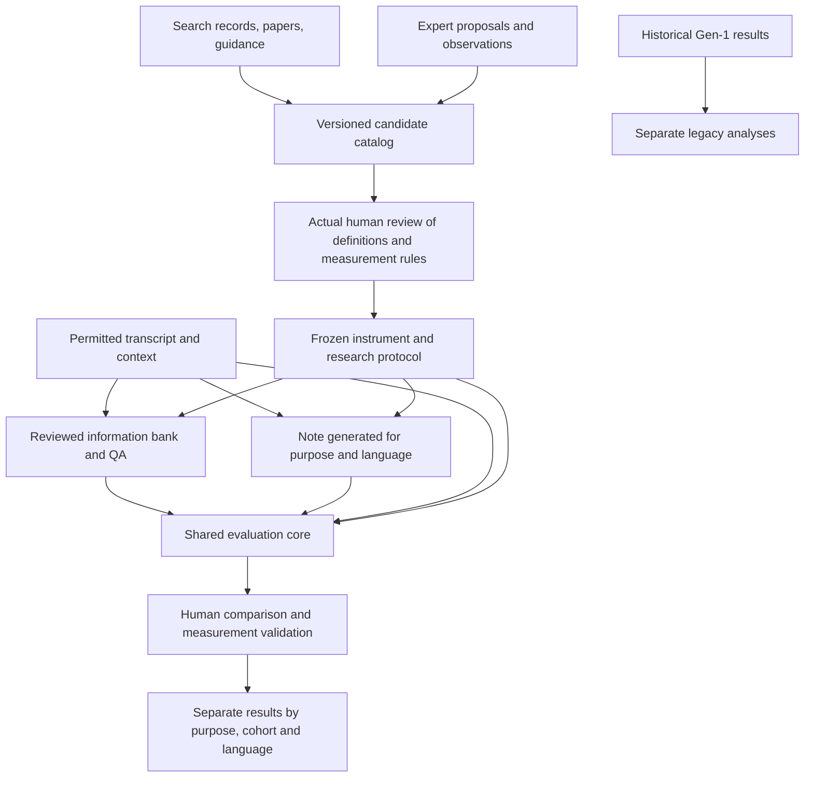

# Repository audit and repair plan — 15 September 2026

**Verdict: retain the software foundation and historical results. Reconcile the
research records and executable design before launching a Gen-2 study.**

This is the single repair backlog for this audit. It does not itself change the
research protocol, approve candidates, import human decisions or authorize a run.
Earlier protocols and reviews remain historical evidence, including their errors.

Audited baseline: `c67f56202c6ca66a36daace21e6d5f9506b5b186`, initially clean.
The attachment supplied on 15 September describes decisions and intended changes;
it is not evidence that those changes are implemented. In particular, protocol
2.1.0 has not replaced the executable 2.0.0 at this baseline.

**Repairs recorded later the same day**, each in the finding it answers below:
A01 (both repositories), A02, A03, A05, A06, A07, A08, A09, A11, A12 and A13
carry a status line naming the commit; A04 is bounded by decision D6 in protocol 2.1.0 rather than completed;
the pool defect found while building the ledger (a cited reference's DOI as a
record key) is repaired in commit `926fa4c`. Findings without a status line are
still open.

## Scope and verification

Inspected the main repository's Gen-1 and Gen-2 entrypoints, research records,
registries, metrics, provenance checks, data restrictions, tests, CI, packaging,
published claims and integration tooling. Inspected the sibling
`czech-therapy-notes` configuration, CLI and judging paths read-only. Checked
selected consequential interpretations against locally available primary texts;
this is not a new database search or a complete independent review of every paper.
No provider requests, credential reads or clinical-text outputs were needed.

Verification artifacts are under `local/audit-2026-09-15/`:

- `audit_checks.py` and `audit-checks.json`: reproducible metadata, registry loading,
  source-file checksums and a synthetic transport probe.
- Ruff check and format check passed for the CI lint scope: 115 Python files.
- All nine database-query export hashes and the deduplicated pool hash matched
  their recorded files. This verifies artifact integrity, not search sensitivity.
- A fresh core wheel built offline using the existing local UV cache. It installed
  into a separate environment without `tnb`; its demo generated 24 synthetic
  notes for four purposes and made zero API calls.
- The ordinary full pytest invocation reached the end but failed on Windows
  temporary-directory permissions, including final cleanup. It is not a passing run.
- A second run used `run_tests.py`, an audit-only workaround that makes
  `mkdir(mode=0o700)` inherit the workspace ACL **only below this audit's temporary
  directory**. Test and production sources are unchanged. It finished with
  **1,282 passed, 2 failed and 2 skipped**. Both failures raised Windows permission
  errors; details are below. This workaround is not a shipped repair or a clean
  passing full-suite result.

Tests verify program behavior. They do not validate the research synthesis,
clinical importance, translation meaning or LLM judge accuracy.

## What actually exists

| Component | Verified state | What that does not establish |
|---|---|---|
| Gen-1 benchmark | Historical results, versioned scoring, public reports and calibration infrastructure | Clinical readiness or transfer to Czech practice |
| Shared Gen-2 core | Version 0.3.0, run protocol gen2-v3; builds and runs independently | A selected, validated instrument |
| Research protocol | Executable 2.1.0 since 2026-09-15 (commit `4da6055`); 2.0.0 retained in `history/` | That any decision has been acted on: no screener, rater or pilot run yet |
| Executed search | PubMed and ACL exports; corrected deduplicated pool of 10,059 records | Completed screening or a completed scoping review |
| Research map | 29 candidate constructs, 17 methods and 14 proposed pilot entries, in a local custom schema | 14 operational, reviewed measurements accepted by the evaluator |
| Human research review | No actual human screening decisions in the search record; research workspace reports zero human responses and instrument snapshots | Independent review or expert consensus |
| Imported pilots | Three English, three translated Czech and ten native Czech cases; only case artifacts in these workspaces | QA banks, candidate notes, evaluations or completed pilots |
| Czech integration | Patch preparation exists; sibling dependency, lockfile and CLI contain no Gen-2 integration | A functioning shared deployment in both repositories |

The research workflow's local status still reports zero searches while the
separate executed-search records describe the real search. These are disconnected
workflows, not evidence that the search did not happen.

## Findings, ordered by consequence

### A01 — Data restrictions are incomplete across repositories and transport methods

**Status: repaired on 2026-09-15.** Main repository: `count_tokens` is guarded like
`ask` and a mock transport shows a denied judge makes no call (commit `7ad094b`).
Sibling: the guard is ported to every judge construction in its CLI and tools,
its real tasks stay confined to e-INFRA and its translated tasks, public AnnoMI
content, are released (sibling commit `aab7e12`, decision D5). The historical
data-governance questions stay open. The text below is the finding as audited.

**Priority 0, confirmed.** The main `Judge` requires named tasks and rejects a
confined task on a disallowed backend. The sibling still has
`Judge(config)` and its Czech scoring commands construct it without task
restrictions. The main-repository repair has not protected the sibling.

There is also a smaller hole in the main implementation: a judge created with
`tasks=()` refuses `ask()`, but `count_tokens()` forwards its prompt to the
transport. The synthetic probe confirms that forwarding; the Vertex transport
implements it as an HTTP request containing the text. No actual request was made
in this audit, and no new disclosure is inferred from the probe.

**Repair:** enforce authorization before every text-bearing network operation,
including token counting, in both applications. Test with mock transports and
both allowed and denied cases. Until repaired, do not execute sibling judging on
real-session derivatives. The intended first pilot excludes real clinical cases
according to the latest supplied context.

The historical events in [incidents.md](incidents.md) remain a separate open
data-governance matter. A code fix does not resolve the location of old caches,
permitted processing or the controller's decisions. Preserve the audit trail;
do not delete evidence as an incidental cleanup.

Evidence: [main judge](../src/tnb/judge.py), sibling `src/tnb/judge.py` and
`src/tnb/cli.py`, [confinement tests](../tests/test_corpus_confinement.py).

### A02 — There is no single current executable study design

**Status: repaired on 2026-09-15 by commit `4da6055`.** Protocol 2.1.0 lists the
eligible cohorts, the record-not-cap rule, the reviewer roles and the human anchor
with a decision ledger; the planner derives its strata from that list and refuses a
native case; 2.0.0 is retained in `history/`. The text below is the finding as
audited.

**Priority 1, confirmed.** README and research documentation say the first round
carries every review-supported measurement. `protocol.json` still says 8–12,
includes two native Czech cases and plans one human investigator. `pilot.py`
enforces the maximum, requires all three cohort keys, four purposes and the
original balanced human-note count. Setting `native_czech` to zero alone will
still fail its cohort-set check. Merely changing the maximum to 14 will not
implement the later design.

**Repair:** one prospective amendment with an explicit parent, decision origins,
scope, human roles, eligible cohorts, workload and analysis plan; then update the
planner and generated documentation together. Preserve protocol 2.0.0.

The original 8–12 target was a feasibility convention, not a methodological error
because it was investigator-chosen. Likewise, four purposes are legitimate design
choices, not discoveries that need to emerge from clustering. An amendment should
explain the changed objective, not claim that every prior convention was invalid.

Evidence: [protocol](../research/gen2/protocol.json),
[planner](../packages/therapy-note-eval-core/src/therapy_note_eval/pilot.py),
[research README](../research/gen2/README.md), [Gen-2 documentation](gen2.md).

### A03 — The literature map is not connected to the executable registry

**Status: repaired on 2026-09-16 by commit `a9b4867`.**
`research/gen2/catalog/convert_to_registry.py` converts the catalog into
`draft-registry.json`, which the core loads and refuses as a pilot instrument;
`conversion-diagnostics.json` lists every pilot entry, method and origin reference
that did not map, and no reviewer name or acceptance is synthesized. The text below
is the finding as audited.

**Priority 1, confirmed.** Loading the local `outputs/gen2-registry.json` through
`load_registry` fails with `ValidationError: artifact: unknown fields`. It uses
`candidates`, `pilot_proposal` and different method identifiers instead of the
core's typed sources, evidence, constructs, measurement specifications and reviews.
The core correctly refuses it. No actual reviewed instrument snapshot bridges
these representations.

**Repair:** retain the wide research catalog, but define an explicit conversion
to a draft `InstrumentRegistry`. Preserve source and candidate identifiers,
historical origin and later support separately. Produce a diagnostic for every
unmapped or underspecified entry; never synthesize an acceptance or reviewer name.
Freeze only after actual human responses on exact revisions.

### A04 — Screening remains incomplete; a second check of 192 candidates is insufficient

**Status: bounded, not completed (decision D6, protocol 2.1.0).** The second
screener covers the priority stratum and the audit sample; the remainder and the
two unsearched databases are reported as limits; the work is named a scoping
search with a prioritised evidence map. The pool correction of commit `926fa4c`
added twenty records to the priority stratum, listed as not screened, never as
excluded. The text below is the finding as audited.

**Priority 1, confirmed.** There are 487 AI-screened priority records: 192 inclusion
proposals and 295 exclusion proposals. The 9,572-record remainder includes a
200-record audit sample, which found six clearly relevant and five borderline
records according to AI. It is therefore inaccurate to describe all 9,572 as
never examined, or to treat the estimated misses as human-established eligibility.

Reviewing only the 192 inclusion proposals cannot detect wrong exclusions or
recover the rest of the pool. Thirty-five book-chapter records were left out for
parser reasons, although that is not a substantive exclusion criterion. PsycINFO
and Scopus remain unsearched, and the requirements search is still thin.

**Repair:** decide and document the review's achievable scope before making
completeness claims. For the planned scoping review, complete accountable screening
across the eligible pool, with independent human roles specified and disagreements
retained. If the actual resource permits only a scoped search and prioritized
evidence map, use that name and bound the claims. Add missing database and guidance
searches when access permits, or state their effect as limitations. A second LLM
is not a second human screener.

Evidence: [flow](../research/gen2/review-2026-09-13/flow.json),
[screening code](../research/gen2/review-2026-09-13/screen.py),
[pool builder](../research/gen2/review-2026-09-13/build_pool.py).

### A05 — Retrieval attempts, reports and studies are being counted together

**Status: repaired on 2026-09-15 by commits `6fdf7c9`, `0ff2da3` and `2986a37`.**
`reports.json` keeps one record per report with stable ids, study families,
retrieval events and a derived status; `flow.json` is generated from it and the
records; the fetch script appends events instead of rewriting the log, which is
frozen. The Keren paper (S19) is retrieved after a recorded failed attempt; S4 is
no longer
counted under search and screening; the two Atzil files and the three guidance
documents are recorded. The text below is the finding as audited.

**Priority 1, confirmed.** The flow still lists Keren's `psychres-2026` as not
retrieved. The retrieval log later records the user-supplied PDF as retrieved,
and its stored SHA-256 matches. The source registry also contains its full-text
extraction. Earlier memo passages still say its method remains unverified.
All 16 recorded file/hash pairs checked in this audit match; that supports file
integrity, not interpretation or human review.

**Repair:** stable report IDs, study-family links, retrieval-event history and
one derived current status per report. Generate the flow from those records.
Distinguish database records, supplementary discoveries, methodological guidance,
included reports and underlying studies. Preserve failed attempts but do not
count a later-retrieved report as currently unavailable. Link the Keren/MIND
publications and determine sample overlap before treating findings as independent.

Source discovery, downloading, AI reading, human verification and inclusion are
different events. The statement that S1–S19 were all read in full conflicts with
S5's unavailable status and must not be propagated.

### A06 — Several source interpretations overstate what was demonstrated

**Status: tempered on 2026-09-15 by commit `af6d423`** in the memo, the weighting
docstring and the local catalog; the evidence table's original labels are kept.
The text below is the finding as audited.

**Priority 1, checked against local primary texts.**

| Interpretation needing correction | Defensible statement |
|---|---|
| TN-Eval's five importance labels imply five numerical scoring weights | The labels and agreement on them are documented. The described micro average weights by section item counts; numeric importance weights are a separate convention. |
| Mandatory safety and homework omissions cost the same in our reproduction | The scored 23-item mapping omits the appendix's general safety item altogether. The new Gen-1 weighting analysis already records that omission. |
| Perfect agreement assigning rubric items to SOAP sections proves reliable rating of note organization | It is agreement during rubric design, not validation of P06 on actual notes. |
| Walker versus PDSQI proves training caused the reliability difference; P12 will certainly show a large effect | Different instruments, samples, raters and statistics were compared. Training is advisable, but the causal effect and its size are not established. |
| USD 190 is the expected cost of the proposed handover task | TN-Eval reports the cost of its whole human note evaluation, not P10. Budget P10 from its actual procedure. |
| Differences between two Keren studies are explained by matched note length | Cross-study differences do not isolate length as the cause. Treat controlled length as a proposed experiment. |

Evidence: local primary text `tn-eval.txt`, sections 3.2, 4.1, Appendix A.5 and C;
`pdqi-9-negative-ed.txt`; `questeval.txt`, SummEval description;
[new Gen-1 weighting analysis](../src/tnb/scoring/weighting.py);
[review memo](../research/gen2/review-2026-09-13/review-memo.md).

Preserve original source importance labels in the evidence table. Separately
justify the benchmark's purpose- and case-specific importance categories. The
core already separates essential and supplementary coverage and supports
`not_required`; it is not a single flat coverage score. Severity remains distinct.

### A07 — Candidate removal and merging are hiding important distinctions

**Status: repaired on 2026-09-16 in catalog revision `catalog-v2`.** Every candidate
carries one of the seven states named below with a reason of its own; language
naturalness is back as K30 and redundancy is split from K11 as K31, both as not yet
operationalised; K15 reads as lacking evidence rather than refuted; K17 stays relevant
to individual therapy; K18 separates author-provided citations from evaluator evidence;
K26 says the cases are not prepared for longitudinal evaluation. The text below is the
finding as audited.

**Priority 1.** The current map still drops language naturalness, despite the
subsequent objection. QuestEval's use of separate fluency ratings supports keeping
language quality as transfer evidence; the exact naturalness criterion still
needs Czech and English operationalization and human assessment.

Other decisions also need reopening:

- K11's fraction of on-topic sentences does not penalize repeating the same
  relevant fact. Keep relevance, redundancy and information density distinct.
- Necessary documentation identifiers do not refute data minimization: the issue
  is which information the particular purpose needs. An entire medical record's
  requirements are not automatically requirements for every generated note.
- Individual therapy can contain sensitive information about third parties.
  Lack of group therapy does not make K17 irrelevant.
- Absence from a current generation prompt is not a reason to remove traceability
  from the catalog. Distinguish author-provided citations from evaluator evidence.
- Native sessions exist, but the ten imported cases all have the default session
  index and no validated chronology. Say "not prepared/selected for longitudinal
  evaluation", not "no longitudinal material exists".

Use distinct states for irrelevant, out of scope, not yet operationalized, lacking
evidence, awaiting raters, not measured and measurement failed. These are not
interchangeable reasons to delete a candidate.

### A08 — The 14 pilot entries are not 14 comparable measurements of note quality

**Status: repaired on 2026-09-16, in protocol 2.1.0 and catalog revision `catalog-v2`.**
Each pilot entry carries a record kind and the conversion refuses to make a measurement
of any of them; K08 states its double nature as a content topic and a cross-cutting
consequence, K19 that the decree is a requirements source while the criterion is
compliance, and a families policy says the families are not independent latent
dimensions. P13 carries the exploratory caveats and P14 the numerator, duplicate and
language-specific length-unit conditions. The text below is the finding as audited.

**Priority 1.** P12 is a training/reliability experiment; P09 is a requirements
check; P10/P11 are human use outcomes; P13 is a corpus-level proxy; P14 is a
derived ratio. Counting all of them as interchangeable items obscures workload
and what is measured. A catalog, an executable measure and a study condition
need different records.

The construct catalog needs the same distinction. A named Czech decree (K19) is
a requirements source; the observable criterion is compliance with a specified,
applicable documentation requirement. Risk (K08) is also a content domain and
cross-cutting consequence of errors in faithfulness or coverage. Do not force
these into a single hierarchy of supposedly independent latent dimensions.

P13's embedding diversity is a defensible exploratory diagnostic, not established
personalization. High diversity can reflect errors; low diversity can reflect
genuinely similar sessions. Preserve the same underlying cases and model version,
check source-specific detail with humans, and disclose any faithfulness-based
selection of notes. Generic wording can also be investigated within a single
note against its source; cross-note embeddings are not the only route.

P14 needs a defined numerator, duplicate handling and language-specific length
unit. A short note can have high density while omitting essential information.
Report density with coverage, harmful omissions and comprehensibility. Do not
assume word-normalized ratios are comparable between English and Czech.

### A09 — The primary synthesis and its renderer are local-only

**Status: repaired on 2026-09-16 by commit `a9b4867`.** The English catalog, its
validator, the renderer and the conversion are tracked under `research/gen2/catalog/`;
`docs/gen2-catalog.html` is generated from the catalog and the suite fails when it
drifts. Czech views stay generated locally under the language policy. Historical
origin labels were carried over unchanged. The text below is the finding as audited.

**Priority 1 for reproducibility.** The main candidate JSON, source extractions,
comparison table and output-builder scripts are under ignored `local/`. They
are not reconstructible from a clean checkout of the tracked review records.
Historical provenance is also uneven: earlier candidates are sometimes relabeled
as literature-origin when new support is added.

**Repair:** version a public-safe English catalog, provenance records and renderer
in the repository. Generate the Czech views from the same records under the
language policy. Keep clinical artifacts and restricted article copies private.
Record path-independent digests and tool versions. Review original-to-current
candidate mappings before changing any historical origin labels.

The clinical-fragment check is useful but cannot establish that arbitrary text
is safe: it detects exact normalized overlap, not paraphrases, and has limited
coverage when the private corpus is absent. Do not equate Czech text with clinical
data or make the safety rule the reason research provenance stays unversioned.

### A10 — Human validation and workload are still a design, not a result

**Priority 1 before pilot.** Neither AI extractions nor empty human-review fields
provide a validation anchor. Two psychologists rating 25 notes each is a resource
constraint, not a precision justification. Without overlapping notes they do not
estimate between-rater agreement at all.

**Repair:** separate calibration notes from evaluation notes; specify paired
assignments, repeats, masking, allowable assistance, adjudication and rater roles.
Keep original disagreements. Record actual time for checking banks and claims.
Choose precision targets and sample design explicitly; do not force every
measurement onto every note. Clinicians alone do not validate client reading,
supervision use or documentation audit expertise.

### A11 — Language comparisons require more than paired filenames

**Status: the tool is in place as of 2026-09-16 (commit `6f6c2a0`); the run is not.**
`tools/translate_annomi_cs.py` records the translator as an instrument chosen by a
measured back-translation check, verifies each conversation turn for turn, carries a
human meaning review, and establishes an EN/CS pair only where both held. Nothing has
been selected or translated yet: the protocol still records the instrument as not yet
selected, and the ten earlier translations stay superseded and unused. The text below
is the finding as audited.

**Priority 2, partly implemented.** The new contrast code preserves model and
protocol comparability and reports missing pairs. It correctly warns that equal
bank sizes do not establish equal content. The current imported Czech translations
are grouped conservatively and do not by themselves establish validated EN/CS pairs.

**Repair:** provenance for the original, translation tool/version or explicitly
unknown origin, human meaning review, shared information IDs and documented
differences between language-specific QA banks. Recover older translation history
where possible; regenerate with provenance when it cannot support the intended
analysis. Retain old artifacts as historical, not silently overwritten.

Preserve source-video grouping for AnnoMI; a video ID is not a verified client ID.
The ten native Czech sessions remain one client, regardless of note or item count.

Evidence: [language contrast](../packages/therapy-note-eval-core/src/therapy_note_eval/contrast.py),
[import adapters](../packages/therapy-note-eval-core/src/therapy_note_eval/legacy.py).

### A12 — Gen-1 remains useful, with separate statistical and reporting limits

**Status: the statistical half repaired on 2026-09-16.** `tnb edges --clustered`
runs the dominance test drawing whole AnnoMI videos beside the published run and
writes the comparison to `docs/clustered-edges-<track>.json`: on the rubric two of
the fourteen kept claims fall and the top group gains a system, on PDSQI-9 nothing
moves, and iCARE is not clustered because iHOPE has no video ancestry here. The
published artefacts and the Group column are untouched. `docs/limitations.md` now
says what a survival share is not, and `docs/landscape.md` reads its count of public
resources as a date. The claims in the rest of the documentation against the newer
sources stay open. The text below is the finding as audited.

**Priority 2, separate analysis.** Preserve historical instruments and rows. The
new weighting analysis is explicitly a sensitivity analysis, not repaired original
TN-Eval scores. Gen-1 dominance resampling still samples conversations; Gen-2's
adapter now records the 50-conversation/43-video dependency. Quantify its effect
in a new Gen-1 sensitivity analysis rather than silently changing the tables.

A bootstrap survival proportion of 0.95 is not automatically a 95% probability
that a model is truly better, nor a family-wise error guarantee across all pairs.
New claims need a defined inferential target and multiplicity treatment as
appropriate. Calibration-based judge selection is development evidence; broader
claims require independent validation of the selected protocol.

Review the general claims in [landscape.md](landscape.md) and README against the
newer sources. Date-bounded search findings should not read as timeless claims
that exactly two resources exist. Keep the absence of an iCARE human anchor
visible. The main old agreement-as-ceiling wording has already been corrected;
do not list that completed repair as outstanding everywhere.

### A13 — Integration and local test hygiene still need finishing

**Status: test hygiene repaired on 2026-09-15 by commits `dcaa049` and `de9743a`.**
One fixture creates and removes the private workspace; the corpus profile is
staged outside every test's temporary directory; the directories earlier runs
left under `local/` were removed by fixture pattern only (decision D7). The
sibling integration remains open. The text below is the finding as audited.

**Priority 2.** CI now builds the independent wheel and lints the core: the older
claim that this CI coverage is absent is stale. However, no installed sibling
adapter or verified sibling lockfile was found. A prepared patch is not integration.

The Gen-2 test fixtures create UUID directories directly below `local/` and do
not clean them up. The audit observed over 2,500 such directories. This contributes
to operational confusion and makes actual study workspaces harder to identify.
Fix fixture lifecycle and document workspace roles;
do not bulk-delete local directories containing unknown evidence.

The full-suite attempt also exposed a test-isolation problem: a page/roster test
can cause `corpus.load_or_build()` to write the real published
`docs/corpus-profile.json`. Tests should stage generated artifacts in their own
workspace. Do not solve this by granting broad permissions to production outputs.

## Repair sequence and completion conditions

This is an implementation sequence, not a claim that literature retrieval or
human validation can be completed by a coding assistant alone.

| Step | Deliverable and owner | Completion condition |
|---|---|---|
| 1. Close data paths | Developer: protect judging/token-counting in both repos. Investigator/controller: handle historical data decisions separately. | Mocked denied requests make zero transport calls; public/allowed cases still work; unresolved historical decisions remain explicitly open. |
| 2. Reconcile the design | Investigator + developer: one prospective protocol amendment and decision ledger, then the matching planner/docs. | Public and translated cohorts can be planned without native cases; expert candidates remain eligible; workload and rater roles are explicit; old protocol stays readable. |
| 3. Repair the evidence ledger | Research assistant drafts; humans review key inclusion/extraction decisions. | Stable report IDs, current retrieval states, linked study families, corrected flow and interpretations; AI proposals remain AI proposals. |
| 4. Complete or explicitly bound the review | Investigator/reviewers, with institutional database access where available. | Screening and full-text status account for the chosen scope, including exclusions and remainder; no false completed-review claim. |
| 5. Rebuild one candidate catalog | Investigator + developer: typed records, origin history, source locations, units, methods and conditions. | Naturalness and unresolved important items are visible; JSON, tables and graph derive from one versioned catalog; conversion to a draft runtime registry succeeds without invented human approval. |
| 6. Perform calibration and freeze a development instrument | Appropriate human raters; developer supplies the interface and exact revision binding. | Checked definitions/EN-CS wording, source banks, atomic claims and controls; actual response artifacts; a bounded assignment and analysis plan. |
| 7. Execute and assess the development pilot | Authorized models and human raters. | Report errors, missingness, uncertainty, time and cost per measurement/cohort/purpose; keep/revise/defer/reject decisions have reasons. No required high score and no premature model ranking. |
| 8. Integrate and prepare later validation | Developer: immutable shared-core pin, lockfile and both adapters. Investigator: independent validation design. | Clean installs and mock end-to-end checks for both repos; confirmation design reflects pilot variation and independent sampling units. |

Steps 3–5 may proceed iteratively. A preliminary feasibility exercise can precede
completion of the whole scoping review if explicitly labeled and versioned as
development; it cannot become the final literature-derived instrument by omission.
Step 8's software integration can proceed alongside reference preparation after
the contract is stable. Confirmatory validation remains a later study.

Do not create a new free-standing plan at each iteration. Update this backlog's
completion evidence, keep decisions in the protocol's amendment history, and
generate the current status from artifacts. Counts belong in configuration or
derived reports, not in several manually maintained narratives.

## Architecture to retain

The three main evaluation questions remain: what important information survived,
what was added or changed without support, and whether the note serves its user.
QA, claim verification, embeddings and human tasks are measurement options;
they are not interchangeable constructs. Families organize the catalog and do
not establish a fixed dimensional structure or a universal quality score.

## Test completion record

The second full run completed in 229.61 seconds: **1,282 passed, 2 failed,
2 skipped**. The failures were:

- `tests/test_page_runs.py::test_every_key_in_the_page_data_is_read_by_the_page`:
  a standard-library temporary directory outside the audit workaround's root
  raised `PermissionError: [WinError 5]`, including cleanup.
- `tests/test_roster.py::test_a_model_nobody_asked_is_named_as_a_question_not_a_result`:
  replacing the published `docs/corpus-profile.json` from its staging file raised
  `PermissionError: [WinError 5]`.

The log and JUnit report are `local/audit-2026-09-15/pytest-workspace-acl.log`
and `pytest-workspace-acl.xml`. These are environment/isolation failures, not
evidence that the corresponding behavior is correct. The full suite is not
certified passing. No test assertion was suppressed, and no production repair
was applied as part of this audit.

Within that run, Gen-2 core tests passed 88/88, research/provenance tests 54/54,
language-contrast tests 6/6, confinement tests 9/9, and clinical-content checks
12/12. After adding this audit and its README link, the 12 clinical-content
checks passed again in an ordinary invocation without the ACL workaround.
`suite-results.json` records the suite counts and search-export checksum checks.
