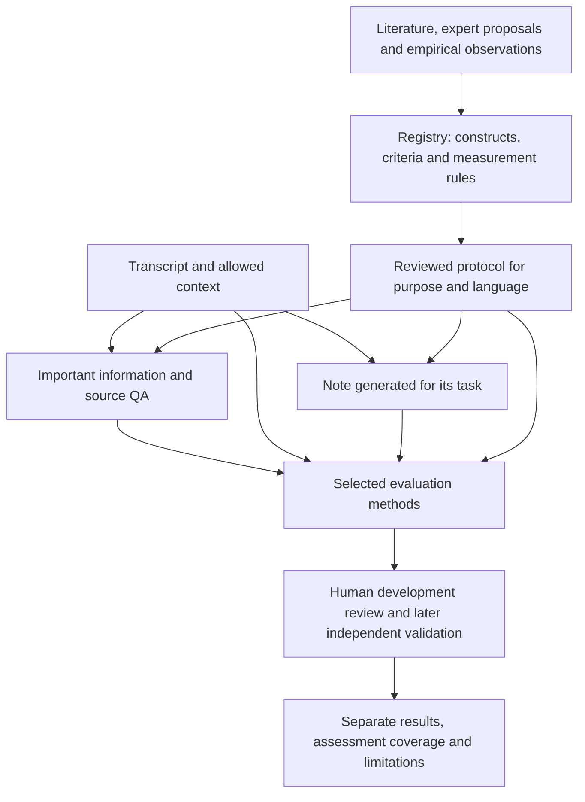

# Gen-2: traceable research and versioned measurement

**Software: experimental v0.3.0 / protocol gen2-v3. Research protocol: 2.1.0, amended
on 2026-09-15 before any pilot run; 2.0.0 is retained in history. The newly specified
review, human pilot and clinical validation are not complete.**

The existing software, prior proposals and earlier experiments are formative
development. They do not predetermine the new instrument. The scoping review has
its own source-derived findings; instrument development also admits attributed
expert proposals and empirical observations throughout development. Historical
origin is distinct from supporting evidence acquired later. We cannot truthfully
claim that every criterion emerged exclusively from the review.

The protocol and executable workflow are in
[research/gen2](../research/gen2/README.md). Source interpretations, construct
selection, operational rules, assessment scope and language wording require actual
human response artifacts bound to their exact content. A name alone is insufficient.
The software checks consistency and lineage, not personal identity or clinical truth.
One investigator with AI assistance is not independent dual review or expert consensus.

What the scoping search proposed is a single versioned record,
[research/gen2/catalog/catalog.json](../research/gen2/catalog/catalog.json): every
candidate construct, method and source, with the historical origin of each idea kept
apart from the support found later. Its readable form is the
[candidate catalog page](https://jannehyba.github.io/therapy-note-bench/gen2-catalog.html);
its executable form is a draft registry that the core loads and refuses to freeze,
with a diagnostic for every entry that did not become an operational item. All of it
is an AI-authored proposal; no entry has been accepted by a person.

Prior drafts may contribute useful ideas without automatically becoming validated
criteria. Igor's QA idea is a candidate method for measuring retained information.
Literature-only snapshots are useful checkpoints; they are not a prerequisite for
expert input. Each revised snapshot names its parent and amendment reason. The
previous research protocol is retained in its historical file, not backdated.

| Purpose | Intended use | Subsequent human validation |
|---|---|---|
| continuity | Meaningfully resume care | Therapists |
| supervision | Understand the documented process and uncertainties | Supervisors |
| client | Understand and use a respectful session summary | Client reviewers and clinicians |
| audit | Check documentation against explicit requirements | Documentation specialists |

Purpose, format, language and instrument are separate. Audit is not legal or
insurance certification. EN-to-EN and CS-to-CS are separate tasks. English demos,
Czech translations, native Czech sessions and synthetic controls are distinct
cohorts. Both item wording and QA/claim method rules need checked Czech versions.
Differences between different corpora cannot be attributed solely to language.

## Installation and demonstration

The independent distribution is `therapy-note-eval-core`, namespace
`therapy_note_eval`. Neither legacy `tnb` application is installed into the
other's environment. Core runtime uses `Python 3.11+`; the optional `research`
extra supplies SciPy and Matplotlib for dendrograms.

```sh
uv sync --all-groups --all-extras
uv run --no-sync tnb gen2 --workspace local/gen2-v3-demo demo
uv run --no-sync tnb gen2 --workspace local/gen2-v3-demo annotate --language cs --limit 1
```

The standalone `therapy-note-eval` executable accepts the same arguments after
`tnb gen2`. The demo creates 24 invented notes and manually authored evaluations
with no API calls. It proves software behavior, not judge sensitivity. Use a new
workspace for v3; v1/v2 manifests remain historical and are never silently rescored.

## Versioned contracts

- `SupportingSource` and `EvidenceRecord`: bibliographic identity, precise source
  location, relationship to the proposed measure, population, language, raters,
  unit, format, validation and limitations. Source checking and human checking
  have explicit states.
- `ConstructDefinition`: a definition, potentially overlapping families,
  evidence references, four-purpose relevance, unit, required inputs, examples,
  applicability, candidate formats, origin and human selection decision.
- `MeasurementSpec`: an operational question, reference mode, binary/ordinal/
  categorical labels and anchors, examples, evidence, purpose and language variants.
- `InstrumentRegistry`: the above records, review-protocol revision, frozen
  instrument snapshot, selected methods and exact human review records.
- `MethodSpec`: construct/evidence links, unit, required inputs, outcomes, applicability,
  severity rules and localized wording for each method, including QA and claims.
- `ReviewDecision`: subject content digest, actual reviewer and role, decision time,
  rationale, imported response identity and explicit superseded decisions.
- `Case`, `Source`, `Turn`: language, origin, grouping, split, permitted providers
  and available source versions. Future sessions are rejected.
- `Bank`, `Information`, `Question`: source-derived content, evidence, epistemic
  status and purpose-specific importance. One primary question per information unit.
- `NoteSpec`, `Note`, `Claim`, `Segmentation`: task, text and generator identity;
  atomic assertions with actor, time, polarity, certainty and exact spans.
- `Evaluation`, `Manifest`: exact population, source, note, bank, segmentation,
  registry, methods, judge, prompt and implementation versions.

Every quote is checked at exact Unicode code-point offsets. Complete character
coverage does not prove semantic atomicity; extraction audit is a separate task.
A correct reference location does not establish semantic support.

## Available evaluation methods

The registry explicitly selects from `qa`, `claims`, `items` and `citations`.
Existing code is a capability, not a decision that a method belongs in the final
instrument. Formats and methods require their own evidence and human selection.

- QA builds important information from the sources before candidate-note exposure.
  The answerer receives only the note and questions. The comparator checks meaning,
  including actor, time, negation and uncertainty, against source-grounded answers.
- Claim verification checks assertions against sources without the QA bank's
  preferred interpretations. Supported, contradicted, unsupported and unassessable
  are distinct. Source-only items may share this call.
- Item assessment separates source-based questions, note-only readability and
  explicit norm/task checks. Ordinal and categorical results retain their labels;
  they are not coerced to pass/fail or averaged into an overall quality score.
- Authored citations use the documented `[evidence:source_id:turn_id]` grammar. Target validity,
  semantic support and claim coverage are distinct from evidence found by the judge.
  Ordinary bracketed clock times are not citations; malformed reserved citations remain visible.

Full source context is the default. Retrieval is an opt-in lexical baseline.
A retrieval miss makes that claim unassessable; it does not prove falsity or discard
all other judgments. Benchmark retrieval itself before relying on it.

## Execution after human research review

```sh
tnb gen2 --workspace local/gen2-study import --input local/study-cases.json
tnb gen2 --workspace local/gen2-study prepare --registry local/reviewed-instrument.json --research-workspace local/gen2-research --provider PROVIDER --model SNAPSHOT --family FAMILY --dry-run
tnb gen2 --workspace local/gen2-study generate --registry local/reviewed-instrument.json --research-workspace local/gen2-research --provider PROVIDER --model SNAPSHOT --family FAMILY --dry-run
tnb gen2 --workspace local/gen2-study segment --registry local/reviewed-instrument.json --research-workspace local/gen2-research --provider PROVIDER --model SNAPSHOT --family FAMILY --dry-run
tnb gen2 --workspace local/gen2-study score --registry local/reviewed-instrument.json --research-workspace local/gen2-research --provider PROVIDER --model SNAPSHOT --family FAMILY --dry-run
```

These examples are planning commands; remove `--dry-run` only for a planned run.
Use the host discovery mechanism to select deployed model snapshots. Every API
attempt reserves from `--max-calls`; a dollar cap additionally requires explicit
input/output prices. Backend retries are disabled. Context is never silently
truncated. Successful validated replies are cached by exact request identity.
Budget objects cover one invocation; a new invocation starts a new budget.
Use distinct `--replicate-id` values for independent scoring/control repetitions.
Their actual calls are separately cached; resuming the same replicate reuses its cache.
Reports separate replicates rather than counting them as independent cases.

Generation and scoring are separate. Notes generated under an older task are not
relabeled as examples generated for a new purpose. Do not send future-session
context to longitudinal tasks. All native real Czech derivatives, including
questions and note-only prompts, inherit the local/e-INFRA restriction.

## Reporting and review

The report preserves planned and eligible denominators, observed subsets,
nonapplicability, unassessable evidence and failed measurements. An ambiguous
answer with a valid partial-content judgment is not an API failure. An empty
note has zero important-content recall when information exists and no perfect
faithfulness score. A deterministic word-limit failure cannot coexist with an
instruction pass in the reported values.
Operational items opt into `word_limit` and `required_headings` checks explicitly.
`--required-heading` defines exact headings on separate lines; no legal requirements
are inferred from a note-format acronym.

`evidence_support` and `evidence_coverage` refer to the judge's evidence.
`citation_support`, `citation_validity` and `citation_coverage` refer to references
written in the note. Incomplete citation checking does not yield a complete 100%
score. Conditional precision is explicitly labelled with its assessed denominator.
Critical-note counts cannot be diluted by correct minor facts. The manifest names
an assessment scope and required methods separately from selected methods. A
negative critical-finding flag requires complete assessment of that declared scope;
missing methods never imply absence. Positive observed findings remain visible
even when other methods fail. Each method exposes planned, applicable, assessed,
missing and unassessable units. Raw finding counts
can overlap between QA and claims and are not counts of independent incidents.
Findings are also counted by the error type the judge named, separately per
method; a verdict carrying several labels is counted under each, so those totals
are labels rather than incidents, and a failed deterministic check counts as an
instruction error.
`link-findings` accepts human-reviewed groups bound to one exact evaluation digest.
A group lists finding IDs such as `claim:c1` and `qa:i1`, its reason and actual
reviewer. Distinct-error counts remain unavailable until every observed finding is
assigned; unlinked findings are not silently assumed to be distinct errors.

Annotation sheets bind case, note, bank, segmentation, instrument and method
versions. They display definitions, anchors, examples and source passages while
withholding automatic verdicts and model identities. Rater role and instrument
authorship are recorded. A developer's blinded review is not external validation.
Sheets record whether model-extracted QA answers were visible; hiding an automatic
verdict does not make every input human-authored. Agreement is reported separately
for each operational item, without pooling unrelated ordinal and binary criteria.
Task sheets withhold reference answers. Pairwise choices include both acceptable,
both unacceptable and cannot decide. Leave unassessed entries blank.

Native Czech sessions currently constitute one client cluster. The TN-Eval
adapter groups the 50 released conversations by their 43 known source videos;
video identity is not proof of client or therapist identity. Translated relatives
must share splits. Single-client data do not receive population confidence
intervals. Published Gen-1 estimates remain historical; their sampling assumptions
are not silently changed by this Gen-2 adapter.

`contrast` compares two languages over the same conversations, pair by pair. It
takes two manifests that agree on everything but the language of the note spec
(cases, banks, corpus and origin may differ; required headings may differ in
wording but not in number), joins cases on their translation group, requires the
two sides of a pair to share a client group, and resamples clients over the
per-pair differences. A metric is compared only where the report's completeness
rule held on both sides; otherwise the entry names the incomplete side instead
of a value. Question banks are built per language, so a recall on each side has
its own denominator, and the output states both bank sizes. An interval crossing
zero does not establish equivalence, and one client gives no interval. The public
form of a contrast carries no free text.

## Data protection and reproducibility

Raw artifacts are immutable and private. Git-backed private roots must actually
be ignored, and artifact paths may not escape through child symlinks. The local
fragment scanner checks all publishable files, including authored Czech resource
files, against normalized corpus fragments. It reports source digests, never
matching patient text. This catches exact overlap, not all paraphrased disclosure.
It cannot scan an absent local corpus; synthetic scanner tests remain in CI.

`export-public` stages an allow-listed aggregate payload in the private workspace.
It excludes raw settings, free-text explanations, transcripts, QA and annotations.
It preserves method selection, required scope, research and measurement revisions,
judge identity, replicate, evaluation coverage, unit denominators and validation status.
Review it before publication. Research artifacts derived from real sessions remain
private even if a literature protocol or safe aggregate can be shared publicly.

CI runs core regressions, research-provenance tests and privacy checks, builds the
independent wheel and tests it without a host `tnb` installation. Windows core
checks exercise the second supported environment. Real LLM sensitivity requires
separate versioned control runs with both correct and deliberately faulty notes;
passing offline tests is not clinical validation.

## Feasibility planning and sibling integration

`pilot-plan --registry ... --research-workspace ... --input ...` takes the exact case
revisions of the protocol's eligible cohorts, currently two English AnnoMI
conversations and their two Czech translations, plus two declared generator and
judge families. It verifies English/Czech translation pairing and provider
permissions, freezes 32 generation jobs, and balances a 16-note human sample across
cohorts, purposes, cases and generators. Native Czech sessions are not eligible:
they are a private track outside the paper and the pilot, and the planner refuses
them by name. The first round carries every measurement the review supported; the
executable count is recorded at freeze, never capped, and what the human budget
cannot cover is reported as not measured. The 120 unique decisions and 30 repeats are
a budget of annotation units taken from the reviewed protocol; two psychologists
additionally rate the human sample in a crossover over languages with an overlap
block and blinded repeats, as a feasibility anchor rather than validation.
Assignment of annotation units still requires reviewed banks and segmentations.
Nothing is executed by planning.

The Czech checkout is not installed or modified by the core. Prepare a reviewable
patch with `python tools/prepare_gen2_czech.py --target ../czech-therapy-notes
--output local/gen2-czech-v2 --revision FULL_COMMIT`. The script requires a real
commit containing version 0.3.0 and pins its subdirectory. `--development` produces
an explicitly local preview instead. Regenerate and verify the sibling lockfile
in staging before applying; local commit existence does not establish remote availability.
The obsolete version-0.1 application helper is disabled.


## Architecture in plain terms

The research workflow defines what should be measured, why, for whom and how.
The registry preserves definitions, historical origins, evidence and unresolved
questions. A reviewed protocol selects the applicable methods for a purpose and
language. The shared core executes them; the two host repositories provide their
own data and permitted model adapters.



QA asks what important information survived, answering from the note alone.
Claim verification checks what was added or changed against the sources.
Purpose-specific criteria assess whether the intended reader can use the note.
For example, changing a suggestion into an agreement may appear in both QA and
claim checks. Reviewed finding links prevent presenting these as two independent
incidents. A passing software test verifies this mechanism; actual human and model
studies must still establish how well the measurement works.
